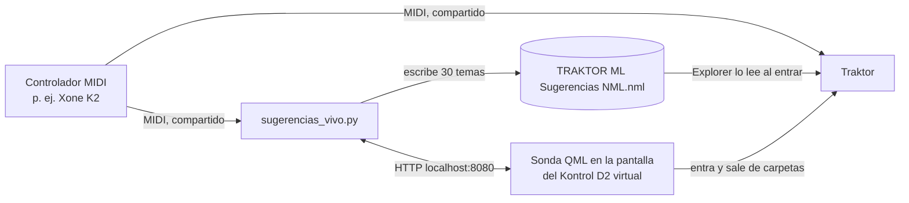

# Sugerencias en vivo en Traktor

Un botón del controlador MIDI muestra, dentro de Traktor, una playlist con temas sugeridos, sin tocar la
pantalla. Otro apretón devuelve el navegador a la carpeta donde estaba el DJ, con el mismo tema elegido.
Funciona mientras se toca: Traktor sigue usando el controlador como siempre.

**Estado (2026-11-05).**

- **Windows:** probado por Gabriel en Traktor Pro 4.4.1 con un Xone K2 (botón Ch15.Note.D0) y la
  DJM-750MK2 como placa de sonido.
  - Desde `#1 BIBO` y `#1 BIBO › PRO`, cada ida mostró la lista recién escrita, en 0,5 a 0,65 s.
  - Cada vuelta llegó a la carpeta con el mismo tema elegido, en 0,6 a 0,8 s.
  - La versión probada tiene la etiqueta `sugerencias-vivo-v1` en GitHub.
  - La versión para Windows y macOS (`sugerencias-vivo-v2`) se probó en Windows el mismo día, con el
    lanzador `.bat`: idas de 0,4 a 0,75 s, también desde el pendrive `D:`, y vueltas de 0,6 a 1,1 s,
    también a una carpeta cuatro niveles adentro (`#1 BIBO › PRO › #2 VA - Best Of Toolroom 2015`).
- **macOS:** el código y los tests ya cubren las rutas, el MIDI (python-rtmidi), el instalador y el
  permiso de administrador, pero todavía no se probó en un Mac con Traktor.
- **Los temas (2026-11-06):** los 30 más parecidos por CLAP al tema principal, con el BPM a ±20 del que
  suena y tonalidad compatible (`recomendador.py`; ver «Las sugerencias» abajo). Mientras no hay tema
  principal, o sin el índice de la biblioteca, salen al azar de la colección. La trayectoria del set
  viene después.

## Desde cero en otro ordenador

Para que otro LLM acompañe a una persona en estos pasos, darle `PROMPT_LLM.md`, que está en la raíz
del repo.

Hace falta un ordenador con Traktor y la música de su colección. El repo es público y esta herramienta no
necesita el resto del proyecto: ni modelos, ni `requirements_v4.txt`, ni la música en el repo.

1. **Instalar Git y Python 3.11.** Desde python.org, o desde la Microsoft Store en Windows. Probado con
   3.11 y 3.12.
2. **Bajar el repo:**

   ```
   git clone https://github.com/gbibbo/traktor.git
   ```

   `main` trae todo lo de esta guía. La etiqueta `sugerencias-vivo-v2` es la versión que se probó en
   Traktor, de antes de los arreglos para instalar desde cero. Comprobado el 2026-11-05 en una carpeta
   vacía, como en un ordenador nuevo:
   - el lanzador creó el `.venv` con Python 3.11, sin paquetes extra;
   - encontró el K2 y la colección;
   - el programa arrancó y se cerró bien con Ctrl+C.
3. **Preparar Traktor**, en Preferences > Controller Manager:
   - Importar el mapeo del controlador con Add… > Import TSI > Import Other…. Los de Gabriel están en
     `tools/traktor_live/mapeos/`: el Xone K2 con D0 ya libre, y su teclado. Ver el README de esa
     carpeta.
   - Elegir la entrada y la salida MIDI del controlador. En Windows el K2 aparece como `XONE:K2 MIDI`.
   - Con otro mapeo, borrar la función que tenga en Traktor el botón que se va a usar.
     `tools/traktor_live/mapeo_tsi.py --liberar` lo hace sobre un `.tsi`.
   - Agregar un Kontrol D2: Add… > Traktor > Kontrol D2. No hace falta tenerlo.
   - Elegir la placa de sonido en Audio Setup.
4. **Cerrar Traktor e instalar la sonda una vez**, desde la carpeta del repo:
   - Windows: `python tools\traktor_live\instalar_api_client.py --sonda`
   - macOS: `python3 tools/traktor_live/instalar_api_client.py --sonda`

   Hay que aceptar el permiso de administrador.
5. **Encender la placa de sonido, abrir Traktor y dar doble clic al lanzador:**
   - Windows: `Sugerencias en vivo.bat`
   - macOS: `Sugerencias en vivo.command`

   La primera vez el lanzador crea el entorno de Python en `.venv`. En macOS también instala
   python-rtmidi, y para eso hace falta internet. Si a Traktor le falta la sonda, el programa lo avisa
   al arrancar y dice el comando.
6. **Si el controlador no es un K2 o el botón es otro**, cerrar con Ctrl+C y abrir una vez desde la
   terminal:

   ```
   .venv\Scripts\python.exe tools\traktor_live\sugerencias_vivo.py --midi <palabra del nombre> --aprender
   ```

   En macOS: `.venv/bin/python tools/traktor_live/sugerencias_vivo.py ...`. Queda guardado.
7. **Apretar el botón.** Si el programa dice «No pude llegar», navegar una vez a mano hasta la playlist
   `TRAKTOR ML Sugerencias NML` y apretarlo: aprende el camino.

Si la colección no tiene 30 temas con cue points propios, las listas al azar salen de toda la
colección.

## Cómo funciona



1. **El sistema comparte el controlador.** En Windows (Windows MIDI Services) y en macOS (CoreMIDI),
   Traktor y `sugerencias_vivo.py` leen el mismo controlador a la vez. El programa solo reacciona al
   botón elegido, así que conviene que ese botón no tenga otra función en Traktor.
2. **La playlist es un archivo `.nml`.** El nodo Explorer de Traktor muestra como playlist los `.nml` de
   cualquier carpeta. Si el archivo cambia, Traktor lo vuelve a leer solo cuando se entra a la playlist
   **viniendo de otra carpeta**.
3. **La pantalla del Kontrol D2 mueve el mismo árbol que ve el DJ.** Traktor dibuja la pantalla del D2
   con QML, aunque el D2 sea virtual (agregado en el Controller Manager, sin el aparato). Su navegador
   (`Traktor.Browser`) es el mismo árbol de la ventana: entrar y salir ahí lo mueve en la ventana.
   Traktor no tiene un comando de "volver atrás", y esto lo reemplaza.
4. **El mod `traktor-api-client` conecta Traktor con el programa.** Es de ErikMinekus, con licencia MIT,
   y se copió en `tools/traktor_live/traktor_qml/`. Le agrega a esa pantalla un módulo que avisa por
   HTTP qué hay en cada deck. Nuestra sonda, `ApiBrowserProbe.qml`, recibe del programa órdenes para el
   navegador:
   - `report`: dónde está;
   - `goto`: ir a un camino, saliendo hasta la parte común y entrando carpeta por carpeta.
5. **Al apretar el botón:**
   - el programa pregunta dónde está el árbol y lo guarda;
   - escribe en el `.nml` la lista calculada para el tema principal (30 temas);
   - lleva el árbol a la playlist, pasando por su carpeta para que Traktor relea el archivo.

   Al apretarlo otra vez, vuelve a la carpeta guardada, y Traktor conserva el tema que estaba elegido
   en ella. Si una ida o una vuelta falla, el siguiente apretón la repite.
6. **El tema principal** (`tema_principal.py`; reglas en `docs/DECISIONS.md`, 2026-11-06, puntos 6 y 7).
   Con cada aviso de Traktor y cada movimiento de un fader, el programa decide qué tema manda:
   - si el MASTER de Traktor es un deck, el tema cargado en ese deck;
   - si es el master tempo, el que está al aire con el fader al 90 % o más, prefiriendo la parte media
     del tema (30 a 70 %) a la intro y la intro al final.

   Los faders salen de la DJM con la mezcla externa (CC 17 a 20 en el canal 1 = decks A a D;
   `"faders"` y `"djm"` en `sugerencias_vivo.json` los cambian) y de Traktor con la interna. Qué mezcla
   usa Traktor se lee en `Traktor Settings.tsi`. Si la DJM no está conectada, se anota en el registro sin
   avisar, y sus faders cuentan como arriba. En la ventana aparece una línea «Tema principal: ...»
   por cada cambio.

   Si el programa arranca con Traktor ya abierto, no sabe qué hay cargado ni quién es el MASTER hasta que
   algo cambie: Traktor avisa cada cambio una sola vez. El servicio automático no tiene ese problema,
   porque arranca antes que Traktor.
7. **Las sugerencias** (`recomendador.py`; reglas en `docs/DECISIONS.md`, 2026-11-06, puntos 7 y 8).
   Cada vez que cambia el tema principal, que un tema pasa a tocado o que el pitch cambia el BPM o la
   tonalidad del tema principal, el programa calcula los 30 temas de la biblioteca más parecidos por
   CLAP. Quedan los que tienen el BPM a ±20 del que suena y una tonalidad compatible transponiendo
   hasta 2 semitonos (`docs/HARMONIC_COMPATIBILITY.md`). Quedan afuera el tema principal y lo ya tocado
   en la sesión.
   - Tonalidad y BPM: los que analizó Traktor (su colección); si todavía no lo analizó, los de los tags.
     Un tema sin tonalidad no se sugiere.
   - Solo se sugiere la copia del paquete (`<unidad>:\TRAKTOR ML`) que Traktor tiene en su colección.
   - El tema principal se reconoce también si suena desde la carpeta original (`Música/...`). Si no está
     en la biblioteca, quedan los compatibles por BPM y tonalidad, del BPM más cercano al más lejano.
   - El cálculo tarda unos 50 ms y se hace antes de apretar: el botón solo escribe la lista y navega.
   - El orden es un promedio pesado de componentes de 0 a 1 (DECISIONS 2026-11-06, punto 9): `clap`
     (parecido), `bpm` (1 con el mismo BPM, 0 a ±20), `clave` (1 la misma tonalidad original, menos si
     hay que mover el pitch), `genero` (1 el mismo género de Beatport, 0 otro; la similitud entre
     géneros vendrá de una taxonomía) y `tiv` (reservado). Los pesos van en `"pesos"` de
     `sugerencias_vivo.json`, por ejemplo `{"clap": 1, "bpm": 0.5}`; por defecto, solo CLAP. Cada
     lista queda en el registro con sus componentes, para ajustar los pesos después.

   Hace falta el índice de la biblioteca, una vez y otra cada vez que cambie la biblioteca, con el
   Python del pipeline (numpy y pandas):

   ```
   python tools/traktor_live/indice_recomendacion.py
   ```

   Sin índice, las listas salen al azar y la ventana lo dice.

## Requisitos

- **Traktor Pro 4**, probado en 4.4.1. El instalador también encuentra Traktor Pro 3, pero no se probó.
- **Un Kontrol D2 agregado en Traktor:** Preferences > Controller Manager > Add… > Traktor > Kontrol D2.
  No hace falta tenerlo.
- **Un controlador MIDI con un botón libre** (nota o CC), solo o con un modificador mantenido. Por
  defecto, en el Xone K2 de Gabriel: **mantener D#0 y apretar D0** (canal 15, notas 15 y 14; desde el
  2026-11-06). En su mezcla externa D0 pliega la biblioteca, condicionado en Traktor a M6 = 0, y D#0
  pone M6 = 1 mientras está apretado; en la interna, D#0 es Modifier #1 y D0 no tiene función. Con otro
  controlador, el botón que se aprende (`--aprender`) va solo, salvo que se aprenda con un modificador.
- **Python 3.11** en el `.venv` del repo, sin paquetes extra en Windows. Lo crea el lanzador. En macOS
  hace falta `python-rtmidi`, que el lanzador `.command` instala solo. A mano:

  ```
  .venv/bin/python -m pip install python-rtmidi==1.5.8
  ```

  Ese paquete también está en `requirements_v4.txt`, solo para macOS y Linux.

## Instalación (una vez, con Traktor cerrado)

**Windows:**

```
.\.venv\Scripts\python.exe tools\traktor_live\instalar_api_client.py --sonda
```

- Windows pide permiso de administrador (aviso de UAC).
- El resultado sale en la ventana nueva, que se cierra con Enter, y en
  `artifacts/v4/traktor_backups/instalar_api_client.log`.

**macOS:**

```
.venv/bin/python tools/traktor_live/instalar_api_client.py --sonda
```

- Si la carpeta de Traktor no es escribible, macOS pide la contraseña de administrador.
- Traktor se busca en `/Applications/Native Instruments/Traktor*/Traktor*.app/Contents/Resources/qml`.
- Modificar archivos dentro de la app es lo que indica el mod original para Mac, pero puede afectar la
  firma de la app. Si macOS no deja abrir Traktor, desinstalar con `--uninstall`.

**Qué hace el instalador en los dos sistemas:**

- Busca el Traktor más nuevo instalado. Con `--d2 <carpeta qml/CSI/D2>` se elige otro.
- Agrega dos líneas al `D2.qml` instalado, copia `Api/` y agrega la sonda a la pantalla del D2.
- Antes guarda una copia de lo que toca en `artifacts/v4/traktor_backups/`.
- Con Traktor abierto no cambia nada.
- `--status` muestra el estado y `--uninstall` deja todo como estaba.

Al actualizar Traktor, el instalador de NI puede reemplazar esos archivos: volver a correr esto.

## Uso

**Automático, la forma normal.** Se activa una sola vez con doble clic en
`Activar sugerencias automaticas.bat` (Windows) o `.command` (macOS). Desde ahí:
- un proceso sin ventana arranca solo al iniciar sesión: en Windows, un acceso directo en la carpeta
  Inicio; en macOS, un LaunchAgent;
- cuando se abre Traktor, prende las sugerencias y muestra la notificación «Sugerencias en vivo: Listo»;
- cuando Traktor se cierra, suelta el controlador.

Los problemas también llegan como notificación, siempre sin sonido para que nada salga por el equipo.
Todo queda en `artifacts/v4/traktor_live/servicio.log`. Para ver cómo está, correr
`tools/traktor_live/sugerencias_servicio.py estado`; para quitarlo, `... quitar`. En Windows también
sirve el mismo `.bat` con `estado` o `quitar`.

Si el controlador se desenchufa y vuelve, o aparece después de abrir Traktor, el programa lo vuelve a
abrir solo.

**A mano, para ver lo que pasa en una ventana:**
1. Encender la placa de sonido (la DJM). Ver *Problemas* abajo.
2. Abrir Traktor.
3. Abrir `Sugerencias en vivo.bat` (Windows) o `Sugerencias en vivo.command` (macOS) con doble clic, o
   correr `tools/traktor_live/sugerencias_vivo.py`.
4. La ventana tiene que quedar abierta mientras se toca. Con el automático activo y Traktor abierto,
   la ventana avisa que el puerto está ocupado: ya está corriendo.

Opciones; lo que se elige queda guardado para la próxima vez:

| Opción | Para qué |
| --- | --- |
| `--midi <palabra>` | Otro controlador: una palabra de su nombre (`--listar` muestra las entradas). Por defecto `K2`. |
| `--aprender` | Elegir otro botón apretándolo. Sirve una nota o un CC (valor >= 64). Para usar dos juntos, mantener el modificador y apretar el otro; `"modificador": null` en los ajustes lo quita. |
| `--n <N>` | Temas por lista (30). |
| `--dir <carpeta>` | Carpeta del `.nml`. |
| `--backend winmm\|rtmidi` | Motor MIDI. Por defecto `winmm` en Windows y `rtmidi` en el resto. |
| `--listar` | Mostrar las entradas MIDI y salir. |
| `--collection <archivo>` | Otra `collection.nml`. Por defecto la de `Documentos/Native Instruments/Traktor*`. |

**Si Traktor muestra la carpeta por otro camino** (por ejemplo en macOS, si el disco tiene otro
nombre), el programa avisa que no pudo llegar. En ese caso:

1. Navegar una vez a mano hasta la playlist `TRAKTOR ML Sugerencias NML`.
2. Apretar el botón.

El programa aprende ese camino y lo guarda.

## Dónde quedan las cosas

| Qué | Windows | macOS |
| --- | --- | --- |
| Playlist de sugerencias | `C:\TRAKTOR ML Sugerencias\` (raíz de la unidad del usuario) | `/Users/Shared/TRAKTOR ML Sugerencias/` |
| Ajustes (botón, controlador, camino aprendido) | `artifacts/v4/traktor_live/sugerencias_vivo.json` | igual |
| Registro de cada sesión (`.jsonl`: avisos de Traktor, pulsaciones, faders de la DJM, mezcla, tema principal, temas tocados y cada lista calculada) | `artifacts/v4/traktor_live/` | igual |
| Índice de la biblioteca para las sugerencias | `artifacts/v4/traktor_live/indice_recomendacion.json` | igual |
| Copias de los QML de Traktor | `artifacts/v4/traktor_backups/` | igual |

En Windows la playlist no va en la carpeta personal porque la pantalla del D2 vio vacía
`C:\Users\bibbo` (2026-11-05). En macOS va en `/Users/Shared` por la misma razón: así no pasa por la
carpeta personal.

## Problemas frecuentes

- **El controlador no hace nada en Traktor.** Si la placa de sonido no estaba encendida al abrir
  Traktor, Traktor cambia solo a la tarjeta interna, borra el ruteo y el mapeo deja de responder
  (2026-11-05). Pasos:
  1. Cerrar Traktor y encender la placa.
  2. Abrir Traktor.
  3. Revisar Preferences > Audio Setup: DJM-750MK2 ASIO, Master 3/4, Monitor 1/2.
- **El controlador no hace nada en Traktor y el programa tampoco ve el botón.** Con la placa encendida,
  el controlador o su driver puede quedarse colgado: no manda MIDI a nadie (2026-11-06, el K2).
  Para confirmarlo, correr `python tools/traktor_live/midi_monitor.py --port K2` y mover algo: no
  aparece nada, mientras la DJM sí manda su reloj. Arreglo: desenchufar el USB del controlador,
  esperar 5 s y volver a enchufarlo. Si Traktor no lo retoma, elegir de nuevo su In-Port o reiniciar
  Traktor.
- **«La pantalla del D2 no responde».** Falta algo de esto: Traktor abierto, el Kontrol D2 agregado en
  el Controller Manager, o la sonda instalada (`instalar_api_client.py --status`). Cargar un `.tsi`
  completo reemplaza el Controller Manager: si esa configuración no trae el D2, hay que agregarlo
  (Add… > Traktor > Kontrol D2) y volver a exportarla (2026-11-06, la configuración de mezcla externa).
- **«No pude llegar».** El siguiente apretón lo reintenta. Si se repite, enseñarle el camino (ver *Uso*).
- **«El puerto 8080 ya lo usa otro programa».** Hay otra ventana de este programa o de
  `traktor_estado.py` abierta: cerrarla con Ctrl+C.
- **macOS: «falta python-rtmidi».** Instalarlo con el comando de *Requisitos*.

## Archivos

| Archivo | Qué hace |
| --- | --- |
| `tools/traktor_live/sugerencias_vivo.py` | El programa: botón, ida y vuelta, ajustes. |
| `tools/traktor_live/midi_io.py` | Entrada MIDI: winmm (Windows) o python-rtmidi (macOS). |
| `tools/traktor_live/traktor_estado.py` | Receptor HTTP del mod y de la sonda (también se usa solo para ver los decks). |
| `tools/traktor_live/traktor_qml/` | El mod `traktor-api-client` (MIT) y `Screens/ApiBrowserProbe.qml`, la sonda. |
| `tools/traktor_live/instalar_api_client.py` | Instala, revisa y desinstala el mod y la sonda en Windows y macOS. |
| `tools/traktor_live/midi_monitor.py` | Monitor MIDI para probar controladores. |
| `Sugerencias en vivo.bat` / `.command` | Lanzadores de doble clic, con ventana. |
| `tools/traktor_live/sugerencias_servicio.py` | El servicio automático: arranca con Traktor, sin ventana, y avisa con notificaciones. |
| `Activar sugerencias automaticas.bat` / `.command` | Dejan activo el inicio automático (una vez). |
| `tools/traktor_live/mapeos/` | Mapeos de Gabriel para importar: Xone K2 con D0 libre y teclado. |
| `tools/traktor_live/mapeo_tsi.py` | Exporta un mapeo de Traktor a `.tsi` y libera botones (`--liberar`). |
| `PROMPT_LLM.md` | Prompt para que otro LLM guíe a una persona a replicar esto. |
| `tests/v4/test_traktor_live_api.py`, `test_traktor_live_platforms.py` | Tests. Corren en Windows, macOS y Linux. |

La historia está en `docs/DECISIONS.md` (2026-11-05) y `docs/LESSONS_LEARNED.md`: cómo Traktor relee
un `.nml`, que el D2 mueve el árbol, y qué pasa si Traktor arranca sin la DJM.
